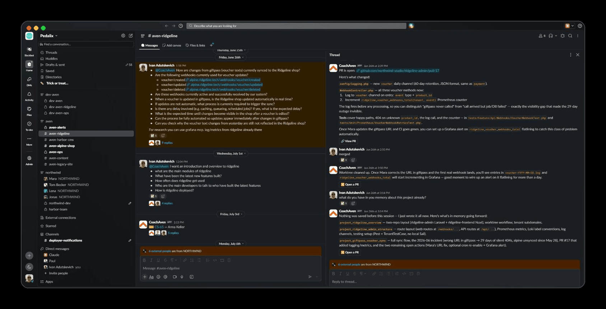
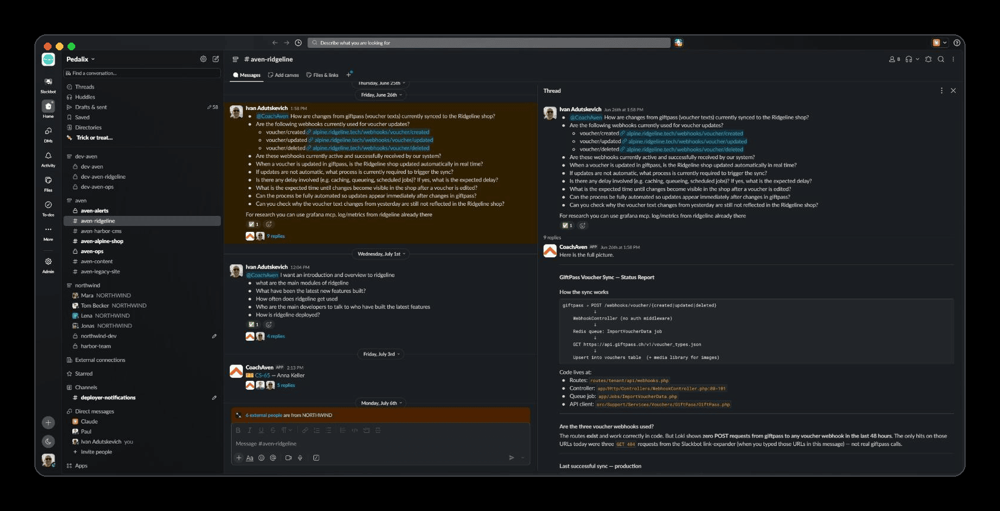
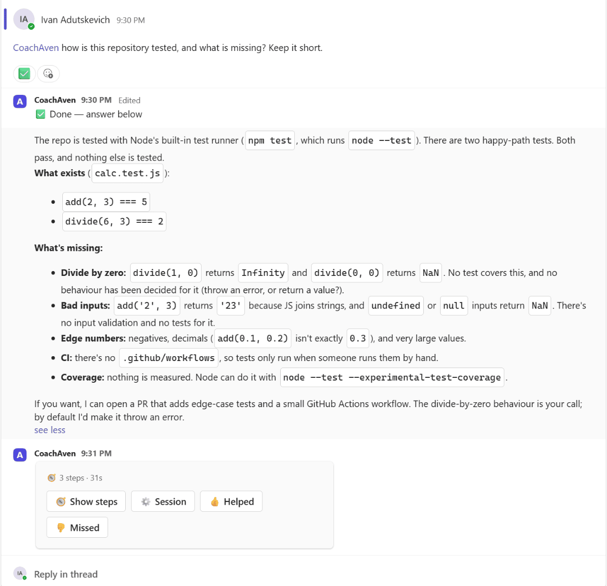

# CoachAven

**A coding agent your team — or your agency — runs in Slack, Microsoft Teams or a web chat. One warm sandbox per
project, on hosts you own.**

- Each project gets a long-running container with its repositories and a persistent **Claude Code** process; a chat
  channel (or web room) drives it.
- The agent reads the code, answers questions, runs builds and tests, and opens pull requests; people review and merge.
- Per project, opt-in: it reviews pull requests as they open, runs routines on a schedule, investigates YouTrack
  tickets, and calls the MCP servers the project declares (Grafana, Sentry, trackers, your own).
- The bot is a small TypeScript control plane with **no model calls of its own**: all the thinking happens in the
  sandboxes, on your model credit — a Claude subscription token to try it, an Anthropic API key for a team or clients.

**Try it on one machine** — Docker, a GitHub account and a Claude subscription; no Slack, no registry, no
privileged container: [`docs/quickstart.md`](docs/quickstart.md). Clone, `./init.sh`, three values,
`docker compose up -d`, and the agent answers in a web chat on `localhost` in about three minutes of machine time.



| The question and the agent's status report (Slack) | A question answered in a reply chain (Microsoft Teams) |
|---|---|
|  |  |

**Built for** an agency or a small team that runs many client systems: one installation, one sandbox and one set of
tools per client project, each client's work billed to a credit you choose. It grew up on Laravel projects (Sail runs
inside the sandbox), YouTrack and Grafana, and runs any stack whose tools fit in a container.

**Why not Anthropic's own Claude Code in Slack?** Their integration runs each thread in an Anthropic-hosted sandbox
tied to Claude Code on the web. CoachAven keeps a warm sandbox per project on your own Docker host, with your
toolchain and the MCP servers your project declares, and adds routines, PR review and ticket investigation. If all you
need is thread-to-pull-request with zero operations, their path is the better choice.

| Capability | Status |
|---|---|
| Slack driver, pull requests, PR review and autofix, routines, YouTrack | production (Slack since June 2026) |
| Project sandboxes on your own Docker host | production for every project since v0.43.0 |
| Microsoft Teams driver | in releases since v0.42.0; canary on a staging installation |
| Agent messaging between installations, through a relay hub | in releases since v0.42.0; canary between three installations |
| Anthropic API key as the model credit | in v0.44.0; canary on the maintainer's installation |
| Web chat (OIDC login; a sign-in link on `localhost`) | canary; the quickstart runs it |
| **Extensions** — sources (a scrubbed store of a project's mail, chat, calendar and tickets) | opt-in; production on one installation |
| **Extensions** — attribution, the lab bench | opt-in, experimental, on the maintainer's own tenant |

Every change reaches the maintainer's installation from `main` first and production with a tag; what is staged where
is the flag ledger, [`docs/rollout.md`](docs/rollout.md).

**Free and open:** everything here is Apache-2.0; there is no hosted tier. Rather not run it yourself? We run and
support installations on a client's own infrastructure — [coachaven.com](https://coachaven.com) — and that is what
funds the project. **No telemetry:** an installation never reports to this project. Besides the services you configure
(chat platform, GitHub, Anthropic, Docker host, MCP servers, YouTrack, sources, an error tracker or relay hub if you set
one) it reads the npm registry once a day to check the Claude Code pin, and pulls its images from `ghcr.io`.
What goes where and what the sandbox can reach: [`docs/security.md`](docs/security.md).

**Versions:** `vX.Y.Z` tags, while the project is below 1.0: a minor release (`0.Y`) may change configuration or
behaviour and says so in its notes, a patch (`0.Y.Z`) fixes. Only the latest release is supported
([`SECURITY.md`](SECURITY.md#supported-versions)); `main` is the canary. Every release is the very image the canary ran.

Status: a single-maintainer project with installations for real users; self-hosting is documented, support is
best-effort ([`SUPPORT.md`](SUPPORT.md), [`CONTRIBUTING.md`](CONTRIBUTING.md), [`SECURITY.md`](SECURITY.md)).

Start here:

- [**Why CoachAven**](docs/why.md): who it is for, what it does differently, what it is not.
- [**How it is built and run**](docs/how-we-work.md): invariants, specs first, canary then tag,
  who does what — built with Claude Code, every change specified first (OpenSpec) and canaried.
- [**All docs**](docs/README.md): running an installation, what the agent can do, under the hood.

## How it works

```
 Slack ⇄ Socket Mode (the bot dials out: no public endpoint needed)
 Teams ⇄ HTTPS (Microsoft dials in: a public endpoint behind your reverse proxy)
 Web   ⇄ HTTPS (the installation serves it: OIDC login, or a sign-in link on localhost)
   │       one chat driver per installation
 orchestrator  (Node, one process; state.json; pollers for routines / PR review / tickets)
   │  sandbox driver: containers on a Docker host you own, over SSH (or this host's own Docker)
   ▼
 proj-<slug> sandbox  ── git clone of the project's repos, one worktree per task,
                         a persistent `claude` process per conversation (stream-json),
                         MCP servers the project declares (Grafana, Sentry, trackers, …)
```

## Self-host with Slack or Teams

You need: Node 24, a Slack workspace where you can create apps, a GitHub App (or token) for
the repos, a model credit (a Claude subscription token or an Anthropic API key, step 4), and a
place to run sandboxes.

1. **Slack app** — create it from [`slack-app-manifest.json`](slack-app-manifest.json)
   (Socket Mode on). Note the bot token (`xoxb-…`) and the app-level token (`xapp-…`).
2. **Sandboxes** — containers on a Docker host you own (`docs/sandbox-drivers.md`): over SSH
   (`SANDBOX_HOST=user@host`), or on this very machine (`SANDBOX_HOST=local`). Keep
   `SANDBOX_DRIVER=ssh-docker` as the template writes it. The containers run a sandbox image
   ([`snapshot/`](snapshot/README.md)): the `plain` one is published with every release
   (`ghcr.io/pedalix/coach-aven-sandbox-plain:vX.Y.Z`), runs unprivileged and on arm64, and is what a project
   without a `sandbox` block gets. A project that needs more (PHP, Sail) gets an image of your own: build the
   `laravel` variant, push it to your registry, and give the project `"sandbox": { "image": "…", "dind": true }`.
3. **GitHub** — a GitHub App installed on the org/repos with *Contents* + *Pull requests*
   read & write, *Checks* read and *Metadata* read; set `GITHUB_APP_ID` + the private key path. (A plain
   `GITHUB_TOKEN` works for a quick trial.)
4. **Claude Code credit** — exactly one of:
   - to try it: `claude setup-token` → `CLAUDE_CODE_OAUTH_TOKEN`;
   - for a team or clients: a key from the [Anthropic console](https://console.anthropic.com/) →
     `ANTHROPIC_API_KEY`. The sandbox can read it, so make it a dedicated key in its own workspace
     with a monthly spend limit.

   Both set stops the boot. A switch applies to new conversations ([`docs/runtime-config.md`](docs/runtime-config.md)).
5. **Config**
   ```bash
   cp .env.example .env                                  # secrets + infra endpoints
   cp projects.config.example.json projects.config.json  # projects: slug, repos[], mcp[], git flow
   npm install && npm run orch -- slack
   ```
6. **A channel per project** named `aven-<slug>` (prefix configurable with
   `SLACK_CHANNEL_PREFIX`) auto-binds to the project; `@mention` the bot there. Project
   prompts go in `projects.d/<slug>.md` beside the config (`docs/runtime-config.md`).

The bot's App Home tab lists every command and button.

Microsoft Teams instead of Slack: the same bot with `orch teams`; its bot identity comes from the `infra/teams/`
Terraform module — [`docs/teams.md`](docs/teams.md)

A web chat the installation serves itself (OIDC login, rooms per project): `orch web` — [`docs/web.md`](docs/web.md) (canary)

Both at once: `CHAT_SURFACES=teams` (or `slack`, `web`) in `.env` runs a second chat driver beside the run mode's, over the same
projects and sandboxes — [`docs/runtime-config.md`](docs/runtime-config.md) → *Chat surfaces*.

Production: the published image `ghcr.io/<owner>/coach-aven` under `docker compose` on any Linux box,
deployed by `npm run ops -- <slug> deploy vX.Y.Z` or by your ops repo's GitHub Action (a rollback is the
same command with the earlier version); each installation's config lives in a private **ops repo**
checked out at `infra/<slug>/` — [`infra/README.md`](infra/README.md), [`infra/deploy/README.md`](infra/deploy/README.md).
Several Slack workspaces on one bot: [`docs/multitenancy.md`](docs/multitenancy.md#enabling-multi-workspace-installs-operator-steps).
Local dev beside a prod bot: [`docs/local-dev.md`](docs/local-dev.md).

## What goes where

| File | Who writes | Holds |
|---|---|---|
| `.env` | you | secrets + infra endpoints: sandbox driver, Slack tokens, GitHub App, Claude token, optional OAuth / MCP gateway / observability |
| `projects.config.json` | you | the project registry: `slug`, `repos[]`, `mcp[]`, `gitFlow`, `youtrackProjects[]`, `sources`, optional `workspaces` (tenant → slugs) |
| `projects.d/<slug>.md` | you | the project's system prompt (wins over the JSON `systemPrompt` field) |
| `state.json` | the bot | sandboxes, tasks, thread → session bindings, installations, routines — never hand-edited |
| `queue.jsonl`, `drafts/`, `usage/`, `feedback/`, `facts/`, `memory/`, `data/` | the bot | journals and derived state beside `state.json` (`docs/`) |

Rule of thumb: a **secret or endpoint** → `.env`; a **description of a project** →
`projects.config.json` + `projects.d/`; everything else the bot derives and you may delete.
`/aven reload` re-reads the project config at runtime (new sessions only).

## Gotchas

- **GitHub token lifetime** ≈ 1h; it is minted and seeded again before every turn. A single turn
  longer than an hour may see a stale token — send another message.
- **Branch protection**: the project's token can push; the `pr` git flow is a rule in the prompt,
  so require reviews on the default branch and let GitHub enforce "people merge".
- **Resources**: DinD wants ≥2 vCPU / 4 GiB per warm sandbox running a Sail stack.
- **State** is one `state.json`; single process per installation. Socket Mode delivers each
  event to one socket only, so a dev bot must be a separate Slack app (`docs/local-dev.md`).

## Contributing

The rules for a PR: [`CONTRIBUTING.md`](CONTRIBUTING.md). Commands, conventions and where things
live in `src/`: the contributor guide [`CLAUDE.md`](CLAUDE.md). How a change ships (`main` is the
canary, production runs the last tag): [`docs/how-we-work.md`](docs/how-we-work.md) and the flag
ledger [`docs/rollout.md`](docs/rollout.md).
