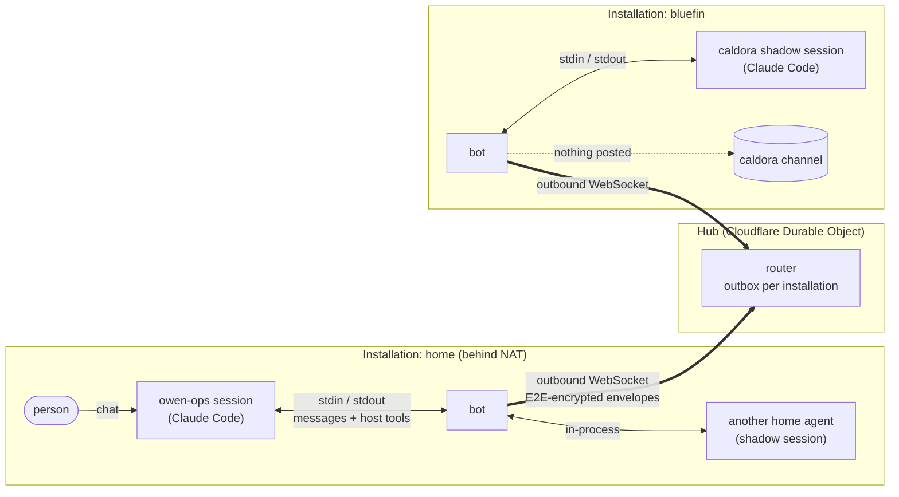
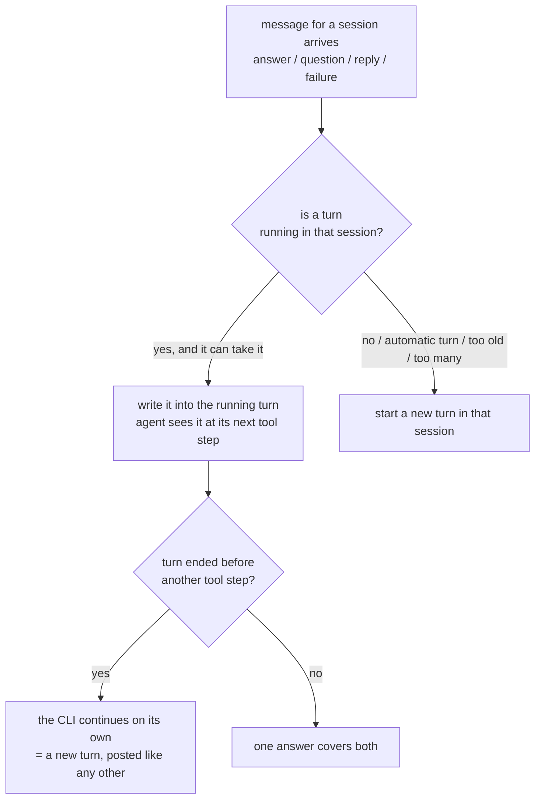
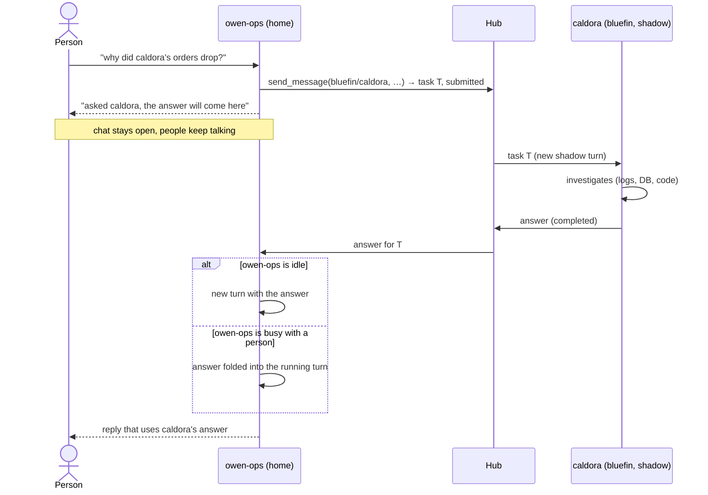
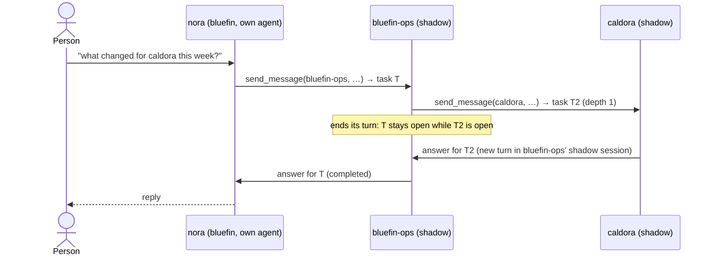
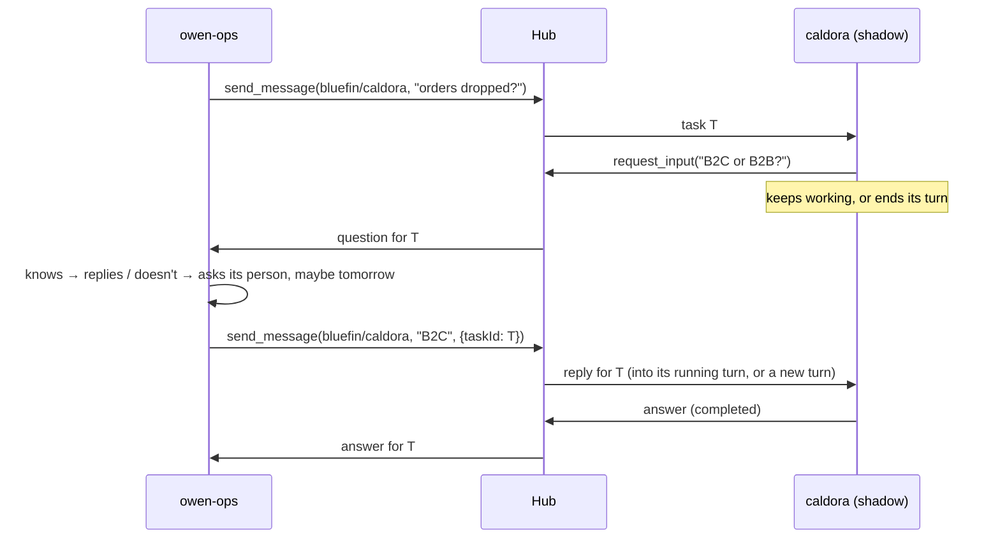
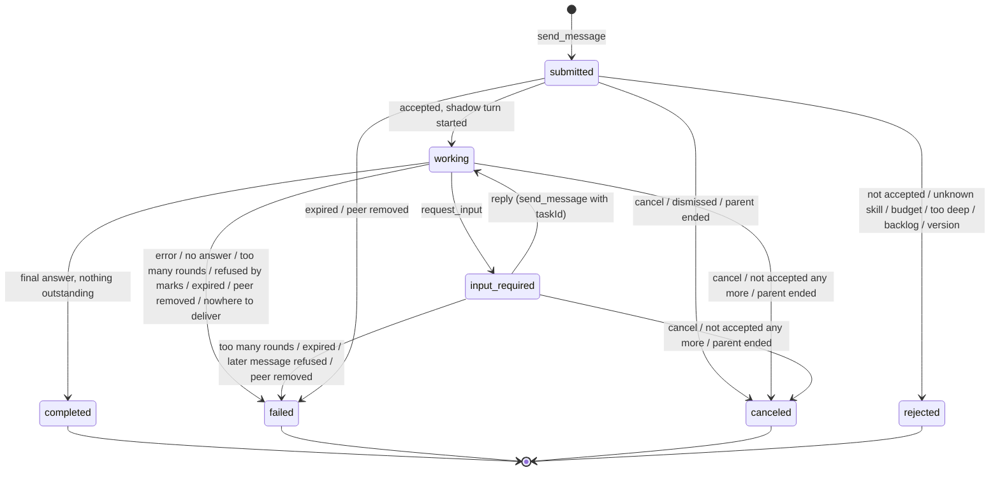

# Agent messaging

Any agent the bot runs can send a question or a request to any agent that accepts it — in the same
installation or in another one — and the answer comes back into the asking session, in the turn it is
running or as a new turn. Messaging is intent-agnostic: no rule or confirmation tells a question from a
request to do work; the receiving agent's accept list is the gate.
The answering agent works in a shadow conversation that never posts to chat. Messages between
installations travel end-to-end encrypted through a small relay (the hub, `docs/hub.md`); messages
inside one installation never leave the bot. Data from one domain does not reach another without a
person. Design and contract: OpenSpec `agent-messaging` (`openspec/changes/agent-messaging/`, archived
to `openspec/specs/` once shipped). It replaced the dispatch primitive (`propose`, `registry`), retired
by OpenSpec `retire-agent-dispatch`.

## Turning it on

Nothing happens without configuration: a project without a `messaging` block behaves exactly as before,
and an installation without any such project and without `HUB_URL` registers no tool, opens no
connection and has no `/aven asks`.

Per project, in `projects.config.json`:

```json
"messaging": {
  "send": true,
  "accept": ["home/owen-ops", "nora", "*"],
  "description": "Orders, payments and partner bookings of caldora",
  "sendPerDay": 50,
  "acceptPerDay": 30,
  "maxRounds": 5,
  "costWarnUsd": 2
}
```

- **`send`** gives the project's sessions the asking tools (`send_message`, `get_task`, `cancel_task`,
  `agents`). Sessions open before a change get the tools after `🔄 Restart session`; withdrawing `send`
  refuses the next call at once (configuration is read at call time).
- **`accept`** lists who may ask this agent: `<installation>/<agent>`, a bare `<agent>` of the own
  installation, or `*` for every agent of this agent's own **domain**. Absent or empty: nobody. No entry
  covers another domain wholesale — another client's agents are always named.
- **Accepting is granting.** Accepting an asker gives that agent — and whoever may drive it — what this
  agent answers. Decide it like any access grant.
- **`description`** is the one line other agents see in `agents` (the agent card).
- **Limits** (defaults shown): tasks this agent starts per day, new tasks per asker per day it takes,
  questions it may ask back per task, and the cost above which a task is reported (`ask.cost.high`).
- A project several tenants share is refused a `messaging` block at load (its domain would be ambiguous).

Between installations, see `docs/hub.md`: `INSTALLATION_ID`, `HUB_URL`, `HUB_KEY_PATH` in `.env`, and
the peers pinned in `hub.peers.json` beside the projects configuration. The variables are listed in
`docs/runtime-config.md`.
- **Pins are the allow list at the hub.** The hub delivers to an installation only from the peers it
  pinned. The `accept` lists stay on the installation, and the hub never sees them.
- **Addresses name installations on the hub this one uses.** `<installation>@<host>/<agent>` is kept for
  other hubs (federation) and refused for now.

## A domain

A **domain** is one tenant of one installation: the installation itself for its home workspace (and for
a single-workspace installation), and one per client workspace on a multi-workspace installation. Inside
a domain, the `accept` lists decide; between domains the marks below apply as well.

## What people see

- **Answers in the thread.** An answer arrives in the asking thread as quoted data from the other agent.
  When it folds into a turn that is already running, that turn's *🧭 Show steps* trail says so
  (`↩ answer from bluefin/caldora (task …) folded in`).
- **✋ Held messages.** When a thread holds another client's data, a message that would carry it to a
  third domain is not sent: a *✋ Held* card shows the target, the text and why, with *Send* and *Dismiss*.
  Anyone who may drive the thread can decide; Send releases it once.
- **`/aven asks`** (operators of the home workspace): the recent tasks between agents, held first, with
  their state, times, cost and first lines; `/aven asks <task id>` shows a transcript (for a task
  answered here, from its shadow journal); `/aven asks cancel <task id>` cancels one.
- **Nothing in the answering side's channels.** The shadow conversation is journaled (`shadow/` beside
  `state.json`), never posted.

## Who uses it

- **A tenant agent across installations.** The operator's tenant agent asks projects that run in other installations, for example "why did caldora's orders drop yesterday?".
- **A person's own agent.** It is fed with that person's work context, and asks the agents that have more access, then answers the person.
- **A routine.** A weekly report wakes up, asks several agents and composes their answers.

## Pieces



- **Agent**: a Claude Code session the bot drives for a project. The project may be a project agent, a tenant agent, or a person's own agent.
- **Bot**: turns agent tool calls into messages and messages into turns. Inside one installation the messages stay in the bot. Between installations the bot is the only thing that talks to the hub.
- **Hub**: admits installations by name — the first key to claim a name holds it, unless the hub's operator reserved it. It routes only between installations that pinned each other, and keeps undelivered envelopes. It cannot read them: it sees the two installations, and the agent names, the method and the task travel sealed.
- **Task**: one conversation between two agents, with an id and a state (A2A).
- **Shadow session**: the answering agent's own session for one task. Its turns never appear in chat.

## Who may ask whom

- **Sending is configured.** A project configured to send gets the sending tools.
- **Each agent lists who may ask it.** Entries are specific agents, or `*` for every agent of its own domain; another domain's agents are always named. The receiving installation checks the list for every message.
- **The hub does not decide.** It knows only which installations pinned which, and drops envelopes from the others before they take a place in a mailbox.
- **Accepting is granting.** Accepting an asker gives the asker, and whoever may drive it, what this agent answers.

## The tools an agent has

| Asking agent | Answering agent |
|---|---|
| `send_message(target, text, {skill?, taskId?})` — start a task (optionally asking for one of the target's skills), or reply on one | `request_input(question)` — ask back |
| `get_task(taskId)` — state, last message (only in the conversation that sent it) | its final answer ends the task, once nothing is outstanding |
| `cancel_task(taskId)` | if its project may send, the asking tools too (a chain) |
| `agents(installation?)` — who accepts me: without an argument, every installation I can reach (mine first, then each pinned peer) with its cards or `offline`; each card lists the skills the agent offers | |

A target is `bluefin/caldora`, or just `caldora` in the own installation. Every tool returns at once, and nobody waits with a turn open. The hub tells no installation who else is on it, so an agent learns its peers' names from `agents()` called without an argument, which lists the installations pinned in `hub.peers.json`.

## Skills: what an agent offers

An agent card says what an agent is (its one-line `description`) and what it can do: its **skills**, the A2A AgentSkill subset `{id, name, description, tags, examples?}` (OpenSpec `agent-skills`). An agent's skills are its project's own Claude Code skills — the same `SKILL.md` files its sessions load — never a second description in the ops repo.

- **The project chooses what to offer.** `messaging.skills` is a list of entries: skill names, globs with `*` (`"newsletter-*"`), and exclusions with a leading `!` (`"!openspec-*"`), which apply after the inclusions whatever their order. The string `"*"` is shorthand for `["*"]`. Without it, the card offers none (`skills: []`) and the project's skills stay internal. Every sender the agent accepts sees the same set; narrowing per sender comes later, with roles. A bad entry fails the configuration load, naming the project.
- **Recommended: `"skills": ["*", "!openspec-*"]`** — every skill of the project except the workflow tooling, because workflow tooling skills are for the agent's own developers, not for other agents. New skills then appear on the card without a configuration change.
- **`["*"]` alone offers everything, development helpers included,** to every sender the agent accepts — and a shadow session runs, like every session, with permissions bypassed. Exclude what is not meant for other agents.
- **Where they come from.** At prepare time, for a project that offers skills, the bot reads the frontmatter of every `.claude/skills/<folder>/SKILL.md` its session loads: the working directory, and for a multi-repo project, when the installation sets `REPO_SKILLS=1`, each repo (`--add-dir`, see `docs/runtime-config.md` → `REPO_SKILLS`). It records them as the project fact `project_skills` (`docs/project-facts.md`). Bundled CLI skills and plugin skills are never offered.
- **Only what really runs is offered.**
  - A skill's id is its **folder** name: the CLI resolves `/name` by folder (a different frontmatter `name` is only reported).
  - A skill marked `user-invocable: false` is not offered: the CLI will not run it by name.
  - A name the CLI itself takes is not offered, since `/name` could run the CLI's command instead (`/schedule`, `/insights`, `/code-review`, …): the CLI's own commands and bundled skills at the project's pinned version — taken from the cli-probe's recorded bare session of that version — a small static floor of built-ins, and plugin commands the project's sessions report in their `init`.
  - A name defined twice (two repos, or a repo and the project folder) is withheld until renamed; the log names both places.
  - These stay withheld whatever the entries say.
  - At most 32 skills on a card.
- **Before the first scan** (no session since the skills were listed) the card offers nothing yet.
- **Asking for a skill.** `send_message(target, text, {skill})` names one of the ids on the target's card; only a task's first message carries it. The receiving installation decides: a skill it does not offer — or a malformed id — ends the task `rejected: unknown skill`, with the ids it does offer (a sender it does not accept is told `not accepted`, as always, and learns nothing about its skills). A rejected task does not count against the sender's daily limit. In the own installation the tool refuses at once.
- **Running it.** The answering shadow conversation starts with the skill's slash invocation, `/<skill>`, followed by the task frame as its arguments: the bot runs the skill, not the prompt. Both task records and `/aven asks` name the skill.
- **No skills is fine.** An agent that offers none works as before: general requests, `skills: []` on its card.

**An offered skill must take free-text arguments.** Its arguments are the whole task frame, which begins with `[Request from another agent]`, the sender and the task id; the request itself follows. So `$ARGUMENTS` is the frame, while positional (`$0`, `$ARGUMENTS[0]`) and named arguments get the frame's first words, not the request's. The request is deliberately not moved to the front: a request that starts with `/` would chain a second skill. Write such a skill to read its arguments as a message.

A `SKILL.md` for a skill another agent may use — `tags` and `examples` are optional, read for the card, and ignored by Claude Code itself (verified on CLI 2.1.292):

```markdown
---
name: brand-profile
description: Builds a brand profile (tone, colours, audience, unique selling points) from a hotel's website.
tags: [brand, hotels]
examples:
  - Build the brand profile for https://hotel-alpenblick.example
  - What is the tone of voice of https://seehof.example?
---
The arguments are a message from another agent; it names the hotel's website somewhere in it.
Read that website. …
```

Caps on the card: name 64 characters, description 300, 8 tags of 40, 5 examples of 200. A malformed key (for example `tags: brand, hotels` instead of a list) is logged and skipped; the skill stays.

## One rule for every message that comes back



- **Framed as data.** What comes back to the asking session is always framed as **data from another agent**, never as a person's instruction. This is the injection and marks guard for what returns. It also lists what is still open from the same conversation.
- **A task reads as a request.** On the answering side a task reads as a request from agent `<agent>` of installation `<installation>`, to be handled as a colleague's request within the project's rules and permissions. It does not tell the agent to change nothing.
- **Delivered once.** It counts as delivered only when the agent's process has taken it up. If the process dies first, it is delivered again as a new turn; while the process lives, it is never sent twice.

## When a task is done

The answering session's final answer completes the task only when nothing is outstanding. Something is outstanding while:
- a question asked back with `request_input` has no reply yet;
- a task the session itself sent is still open;
- a message for the session has not been taken up yet;
- a background subagent is still running.

Until then the answer is kept as a progress note (`get_task` shows it), and the task stays open. If everything resolves and no turn follows, the bot asks the agent once for its final answer. If that brings none, the task fails rather than waiting forever.

## Guard rails

- **No forwarding between domains without a person.** A domain is one installation, or one client workspace inside a multi-workspace installation.
  - A conversation that received data from domain X cannot send it to domain Y, unless Y already had it.
  - It may still answer X, and ask agents of its own domain, which then carry the same mark.
  - In a chat thread the message waits for a person's Send; in a shadow session it is refused.
  - A fresh session starts clean; compaction does not clear it.
  - The bot's own posts in such a conversation are not ingested into the project's sources, so the data cannot come back through the store.
- **Questions and requests alike.** A task may ask for an answer or for work. What the answering agent may do is decided by its own project's rules and its sandbox's permissions, and who may send to it by its accept list.
  - **Grant `accept` only to senders you trust with work.** A grant made when messaging only asked now also allows requests for work.
  - **Nobody approves for you in a shadow session (accepted risk).** A question the answering agent would put to a person (AskUserQuestion) goes to the asking agent, so an accepted peer can approve a risky step itself.
  - **Saved data escapes marks (accepted risk).** What a task carries can be saved on the answering side, in memory notes, tickets or commits, where marks do not follow. The task frame stays plain on purpose, so it is easy to debug.
  - **Planned:** roles per sender in `accept` (reader / contributor), enforced by the receiving bot, for both risks.
- **Limits:**
  - tasks per day on both sides;
  - clarification rounds per task;
  - chain depth 3;
  - injected messages per turn.
- **Fail loudly.** Every refusal, message that cannot be delivered, slow or lost pickup, mismatch, limit and mark is logged. From warning up it reaches Sentry.

## Ask and answer across installations



## A person's own agent asks inside its installation



## Clarification



## Task states



A held new task is a `submitted` task that has not left its installation yet: Send releases it, and Dismiss cancels it. A held reply leaves its task in `input-required` until a person decides.

## What survives what

| Event | What happens |
|---|---|
| Asking bot restarts | Open tasks live in its state, and answers wait at the hub and arrive on reconnect. |
| Bot restarts right after writing a message into a turn | On reattach the bot sees whether the agent took it up; the message is sent again only if the process died. |
| Answering bot restarts mid-turn | The shadow turn is recovered like any chat turn, and the answer still goes out once. |
| Hub unreachable | Messages between installations wait in the sender's state. Local messages and chat keep working. |
| Recipient offline for days | The hub keeps the envelope until it is acknowledged or expires (7 days). |
| Recipient has not pinned the sender | The hub answers `unknown installation`, as for a name nobody holds, and the asking agent is told that the peer may not have pinned it. |
| Sandbox killed before the agent took a message up | The message is delivered again as a turn. |
| A person keeps chatting meanwhile | Their messages are ordinary turns. The answer joins whichever turn is running, or starts its own. |
| Host clock drifts | Nothing breaks, and the bot warns once it is more than 30 s off. |
| A session is compacted | The conversation keeps its marks; only `🔄 Restart session` clears them. |

## Where it can grow

- **Other hubs:** addresses `<installation>@<host>`, kept for federation (OpenSpec `hub-open-network`, which also lists pairing codes, key succession and organisation keys as later steps).
- **Third-party agents:** an A2A HTTP adapter on the hub, translating to the same task shapes, with keys per agent.
- **People in the loop on the answering side:** mirroring a shadow session into a channel, per pair.
- **Permissions per sender:** enforced by the receiving bot, for example read-only or write through the sandbox's permission mode, optionally with an intent check that escalates to a person. Not planned.
