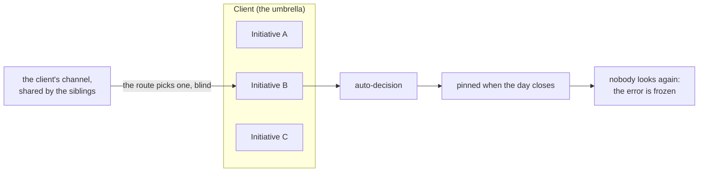
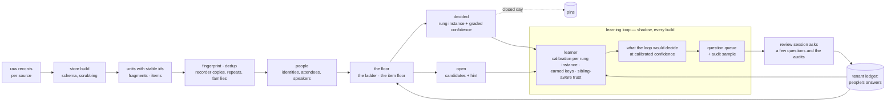
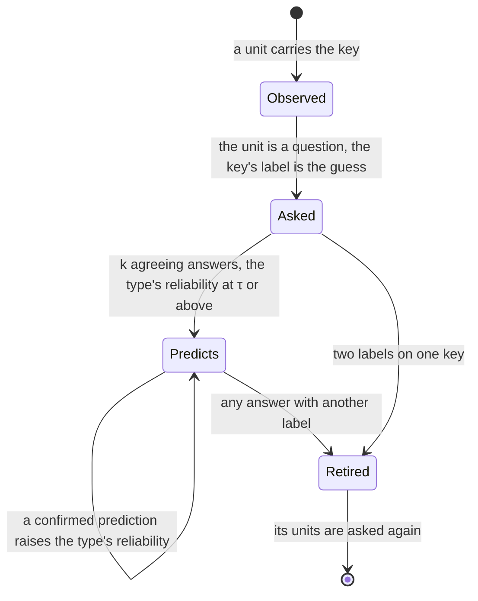
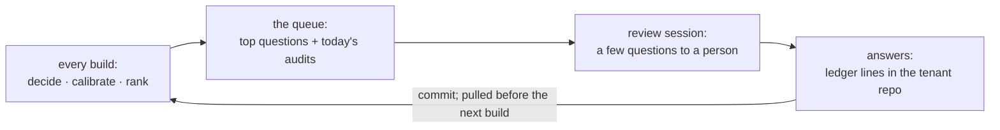
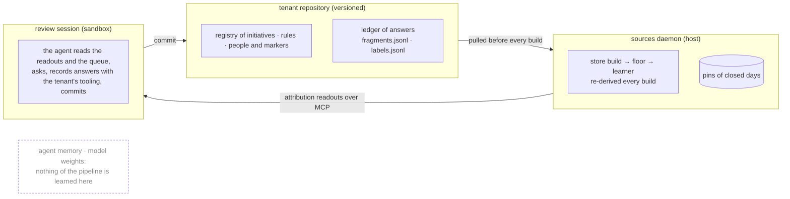
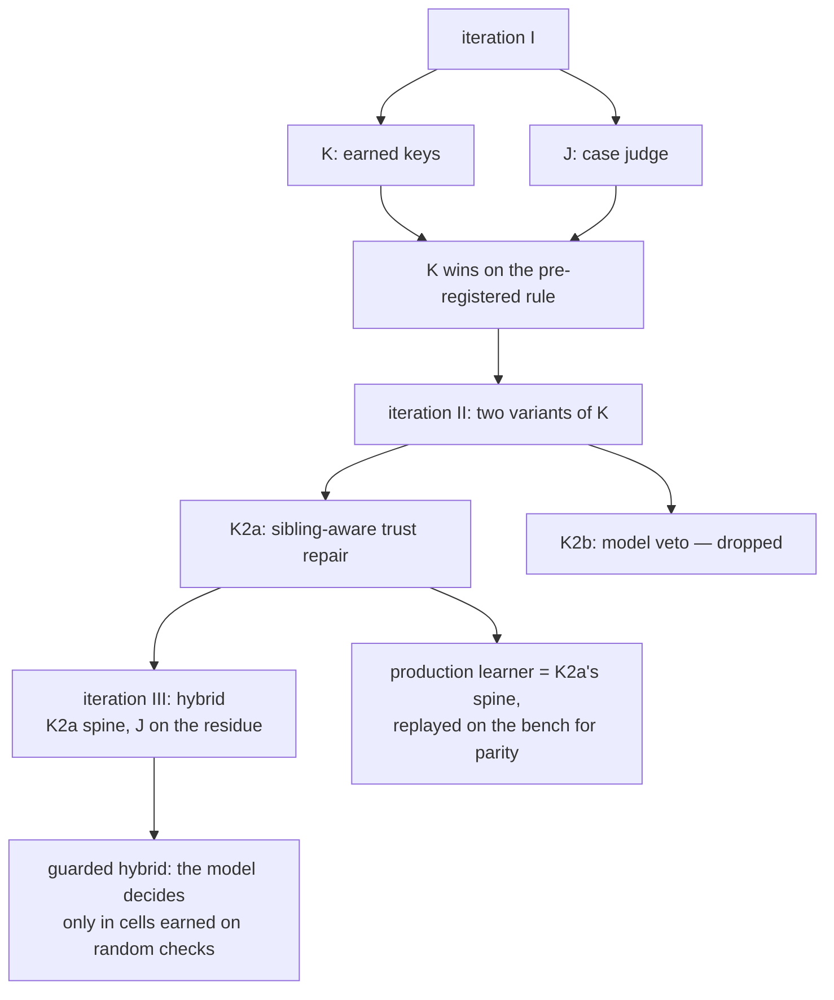

# Attribution and the learning loop — architecture

How the ingest decides what a piece of a tenant's day or stream is about, how it learns from the people who
correct it, and where that is going. This is the architecture; `docs/sources.md` (*Attribution*, *Item mode*,
*Learning loop*) is the reference for config, contracts and readouts, and `docs/lab.md` the bench that measured
every step. Code: `src/sources/attribution/` — the pure modules carry their design notes in the file headers.
Specs: OpenSpec `attribution`, `attribution-items`, `attribution-learning` and `ingest-lab` (the change
`ingest-learning-loop` until it is archived).

**Status.** The ladder, the call participants and the stage-0 fixes run for every tenant that ships
`annotations/attribution.json`. Item mode and the learning loop are opt-in per tenant (`items`, `learn`), and the
loop runs in **shadow**: it derives and shows, nothing reads it — the plan, the pins and the timelog are the same with
it on or off. No production tenant ships an attribution.json yet, so production is untouched until one does. The
review session's model step is unchanged: it still decides (see *The model's place*). What is decided and what is
open is in *Roadmap*.

## The idea: three roles and one rule

| Role | Does | Does not |
| --- | --- | --- |
| **Structure** — a deterministic floor of tenant rules, registry routes and people markers | decides what it can prove; narrows the rest to candidates and a question | guess |
| **The model** — a language model in the sandbox | proposes: words a question, pre-fills its guess; target: decides only inside confidence cells it has earned on random checks | teach, or count as evidence |
| **A person** — the subject or a team member, a few questions a day | confirms or corrects | answer more than a handful of questions a day |

The one rule: **machine output is never evidence.** Trust and calibration grow from people's answers and from random
audits of the machine's own decisions, from nothing else. A system that counts its own decisions as evidence confirms
itself — on the bench, feeding the loop its own decisions as evidence sent its weekly precision down within weeks.
Everything below serves one property that follows from the rule: **an error cannot freeze silently.** Anything
doubtful becomes a question; the right to decide without a person is granted on measured precision and withdrawn by
audit.

## Units and the four answers

Streams differ — chat, mail, calendars, trackers, recorded calls, local activity (git, agent transcripts) — and the
unit is one of two:

- a **fragment** of the subject's day — a topic of a recorded call, a run of the subject's own messages in one
  container, a work block — when the tenant names a `subject`;
- an **item** of a stream — every message, ticket, comment and recording of the last N days — when the tenant sets
  `items` (a team tenant has no subject; a subject's incoming stream has items too).

Per unit the layer answers four questions: **which initiative** (client, then the initiative), **is it a repeat** (a
duplicate cluster, a reuse family), **who took part** (people resolved to the tenant's roster), **what kind of record
and to whom** (noise or not; the addressee). The timelog, the reports and the budget reconciliation stand on those
answers, and an attribution error travels down that chain without a sound — which is why the layer prefers a question
to a guess.

## Where it breaks without a loop

A structural rule — the client's channel, a tracker key prefix — looks reliable, and it is: about the **client**.
When the client runs several initiatives at once (siblings), the route is right about the client and only a guess
about the initiative, every error inside the client, and once such a decision is pinned nothing re-opens it. A model
used as a judge is confident too, but its confidence is calibrated by nobody; let its decisions count as evidence and
the system confirms itself. The loop exists for exactly these two failure modes.

## The pipeline

Order matters, and it is the same for both unit kinds:

1. **Dedup before any model.** Recorder copies of one call merge by the store's call id; repeats, alert episodes,
   cross-posts and forwards cluster by fingerprint; a reuse **family** (sender, text template, the host the text is
   about) is the key a label is reused under.
2. **People before attribution.** Attendees by address and by name, glued invitee strings, the linked calendar
   event, transcript speakers; an item resolves its author, mentions and addressees against the roster.
3. **The floor stops at the first rung that can prove a decision** and never guesses: an ambiguous route is a
   candidate list, not a decision.
4. **Nothing is kept in mind.** Every build re-derives the whole state from the raw records and the tenant's
   files — units, ids, decisions, calibration, questions. Delete the store and rebuild: the same result. The one
   deliberate exception is pins: a rule decision of a closed day is frozen with the rules version that made it, so a
   rule changed later does not rewrite history (`orch sources attribution redo` unfreezes a window).

A build runs after every pull of the daemon (minutes, not nights) and at least hourly; the loop's part costs about a
second with item mode on a month-long window.

## The two floors

**Fragments — the ladder** (`ladder.ts`), strong to weak; the first rung that decides stops it. Every decision carries
its rung's graded confidence (`RUNG_CONF`): a repo route is near-certain, a tenant rule or a ticket key nearly so, a
single calendar-title hit or one admin word are guesses that happen to decide. The ladder decides exactly as the rung
says; the loop reads the confidence.

| Rung | Decides / narrows |
| --- | --- |
| Tenant rules | a deciding rule decides; a `candidates` rule stops the ladder with exactly that set |
| Exclusive markers | a participant who always means one initiative decides — all of them must agree |
| Registry routing | repo/path; channel (id first, then name; shared → candidates); tracker keys (a key outside a shared repo's initiatives leaves the block open); calendar title patterns |
| Admin bucket | money, contracts, visas — whole words — → the counterpart umbrella's admin initiative, when the tenant names one |
| Narrow markers | no decision: candidates narrowed to the person's set |
| Broad markers | no decision: a hint |

Precedence over the ladder: a decision recorded in the tenant's ledger (a person's, or the review session's) always
wins; then a pin; then today's rules.

**Items — the item floor** (`items.ts`), per item in time order so that a reply finds its thread's root decided:
sender class (human, bot, bulk, system) → family → duplicate cluster → initiative → kind → addressee.

| Rung | Decides / narrows |
| --- | --- |
| The ticket's own key prefix | → the registry, when unique |
| A reply | inherits its root's topical decision |
| One-way bulk mail | → `none`: nothing to attribute |
| Bot item: a host or app token | → registry `hosts` / `apps`; an unknown host in a channel with a closed host list → `unregistered` |
| Tracker keys in the text | one decides; several → candidates |
| Tenant rules | project key; container (lower for a bot item — shared bot channels carry mixed traffic) |
| Registry channel | id first, then name; shared → candidates |
| Mail counterpart domain | → its company → that umbrella, as a prior and candidates, never a decision |
| Author / addressee markers | exclusive decides, narrow narrows |

Kind: structure says `noise` (a resolved alert, a bot post that neither fires, fails nor asks, bulk, a role mailbox,
small talk) or abstains. Addressee: explicit mentions, the DM counterpart, a vocative first name, the author a reply
answers, a ticket's assignee, `none` for an integration; the rest sits below τ — a question, not a decision. Constants:
`ITEM_CONF`.

## Learning, in shadow

Switched on by `"learn": {"mode": "shadow"}` in the tenant's attribution.json (`learn.ts`, pure; `learn-load.ts`, its
IO). Three structures, each re-derived every build from people's answers replayed in day order: on an answer's day the
loop decides the unit with what it knew the day before, so every key and every rung instance that predicted it is
graded honestly.

**Calibration per rung instance** (`learn-calib.ts`) — per instance, not per rung type: each channel, each key prefix,
each rule, each title pattern, each exclusive person keeps its own count. An instance starts at its rung's graded
confidence (a Beta prior) and moves with what people said about the units it decided — one count per answer,
however many units the answer covered. An instance that decided on its own and whose calibrated mean falls below τ is
**demoted**: its units become questions with its label as the guess. Two levels per instance: the initiative, and the
client (did the person's label at least belong to the same client). This is how a stale rule or a wrong registry line
is caught — and since auto-decided units are never asked otherwise, only audits and the units sibling trust re-asks
ever reach this count.

**Earned keys** (`learn-keys.ts`). An answer is about a key, not a unit: "this alert family is the shop", "this mail
subject is the retainer". A key is a typed fingerprint of a unit — its thread, its sender's template, its host or
app, its channel, a recurring call title, the set of counterparts, a rare title word, the structure-decided work block
next to it, and the route itself (`ctx`: what answers on a route's units say about the route).

Each key **type** carries a reliability of its own — a Beta prior the bench set as a hypothesis (strong for a thread
or an alert family, weak for a sender or a counterpart set), moved by every prediction a person then checked. A type
decides only while its measured precision stays at τ or above, and a key needs one to three agreeing answers (`k`,
by type) before it may predict at all; two labels on one key end it for good. Keys people confirmed three times become
rule candidates for the tenant.

**Sibling-aware trust** (`learn-trust.ts`) — the repair for the failure mode above. A structural route (a rule, an
exclusive marker, a channel, a tracker key, a title) of a client that runs other active initiatives decides the
**client** at the route's client-level calibration; the **initiative** only when the unit's own text carries a cue
of it and none of a sibling's, or when answers on the route's own units already confirmed it. Otherwise the unit is a
doubt below τ — a confirm question with the route's label as the guess, or the sibling as the guess when only its cues
are present — and such questions are asked once per client and day. A route never vouches for itself: the cue it rests
on (its key prefix, its channel, its pattern) never counts.

**Deciding a unit**, then: the floor's label at its instance's calibrated confidence → sibling trust → the unit's
consistent earned keys, which outrank a floor that sits below τ. A unit a person has answered shows what the loop said
*before* the answer, so the readout's agreement figure is an honest one.

## Questions and audits — the economy of attention

A person's attention is the scarce resource, so the queue is built to buy the most learning per answer
(`learn-ask.ts`):

- **The client first.** Units whose client is decided and initiative is not are one question per client and day —
  "these units of that client today: which initiative?" — one answer closes many units and calibrates the whole
  route.
- **Grouped by what the answer teaches.** Otherwise an item asks about its best learnable key (the one whose answer
  would decide the most later units, weighted by its type's reliability) and a fragment about its case (the call, the
  run-day). A group holds at most a dozen members; the rest becomes a lower-ranked chunk.
- **Valued, ranked, interleaved.** A group's value is its members' uncertainty plus the yield of its key; fragments
  (minute-weighted) and items take turns, so a day's calls never crowd out every item question. The review asks the
  top few (`questionsPerDay`, default 3).
- **A guess makes it a confirm.** When the loop — later, the model — has a label, the question is "is it X?" rather
  than "which one?": confirming is cheaper than choosing, and the guess is recorded with the answer so the machine's
  misses stay visible.
- **A share of the budget is audits** (`auditShare`, default 15 %): units the loop auto-decided today, drawn
  uniformly at random, seeded by the day so every build of a day draws the same sample. Audits are the only unbiased
  look at the machine's own precision; everything else it asks is what it doubted.

## Where the knowledge lives

An answer is tenant data and nothing else: a ledger line a person decided (`decided_by` `owner` — or the tenant's
`ownerDecider` literal — or `human:<person_id>`), with the question it answers (`answer`), what the machine proposed before (`guess`, `conf`,
`rung`) and whether it was an audit (`audit`); for items, a line of `annotations/labels.jsonl`. The daemon fetches the
tenant before every build and re-derives everything from it; the session reads the result; nothing is learned inside
a model or in the agent's memory (`docs/memory.md` is the agent's project memory and holds none of this). So the
recalibration one might expect from a nightly reflection pass is deterministic and happens in every build. What is
left for language — reading the cases where the answer differed from the guess and wording a typed proposal (a rule,
an alias, a host, a new initiative for an unregistered cluster) — belongs in the review session, as questions.

Never evidence: the ledger's `rule` and `model` lines, pins, the floor's decisions, the loop's own output, a model's
guess. A machine line never withdraws a person's answer in `labels.jsonl`; the fragment ledger still keeps its
last-line-per-id rule, which is the first thing to fix before live (*Roadmap*).

## The model's place

**Today.** The review session judges the open rows by content and records its decisions as `model` lines; the plan
takes them as decisions (the ledger wins over the ladder), the loop ignores them as evidence. The bench measured this
judge: far more accurate than the floor on hard cases, not accurate enough to decide unchecked, and its confidence
calibrated by nobody.

**Target: from judge to hinter.** Two independent passes and a verified quote from the text give a confidence
**cell**:

| | quote verified | no quote |
| --- | --- | --- |
| **passes agree** | may earn the right to decide | the guess inside a question |
| **passes disagree** | the guess inside a question | stays open; the model says nothing |

A cell earns the right to decide only on random checks of the decisions it made on its own — not on answers to the
questions it chose to ask, which are no random sample — and loses it by audit. Until a cell has earned it, the model's
label is the guess inside a question to a person: each answer teaches more, and a wrong guess costs the same as a wrong
structural one. On the bench the hybrid without that guard (the model deciding above a threshold it crossed on its
own questions) froze errors again, and a model veto on structural decisions was mostly a false veto on a clean
registry; the guarded hybrid is the version to build.

## What we get and what we lean on

**Advantages**

- No silent freezing: what is doubtful becomes a question, not a pin.
- Provenance on every decision: the rung instance, the confidence, who answered, what the machine proposed before.
- Determinism: the same records and the same tenant give the same decisions; everything rebuilds from raw.
- Production does not change by itself: switched on per tenant, in shadow first.
- One floor for a subject's day and for a team stream without a subject.
- A model only where it pays, and under audit.

**Assumptions**

- The tenant keeps a registry of initiatives that is roughly right; its imperfection — shared channels, stale rules,
  broad patterns — is the normal case the floor is built for.
- A person answers a few questions a day, and their answers are the truth (a correction supersedes).
- Audits are actually asked and recorded; without them precision is unknowable.
- The bench's synthetic tenant is a hypothesis about reality, not reality; the real datasets carry the final word.
- The timelog constrains a day's and a period's totals; it is a weak cue for a single unit, since parallel work is
  the norm.

## The bench, before production

`docs/lab.md`. Frozen real stores outside the repository plus a synthetic agency tenant with exact truth and a
deliberately imperfect registry; gold tiers (people's answers, synthetic truth, a strong model's silver in two passes
with an adjudicator); the headline is the share decided without a person at a required precision, with the threshold
chosen on one part of the data and measured on another, split by case; a day-by-day replay with a person in the loop
under an effort model, random audits and a memory of people's answers only — and a self-poisoning test (what happens
when machine output counts as evidence). Every change of the pipeline is replayed here first.

## Roadmap — what moves next, and by what means

| Step | By what means | Fork | State |
| --- | --- | --- | --- |
| Canary readout → tag → archive the change | two evening reviews with the loop on; `attribution({learn: true})`: agreement with the answers, demoted instances, the questions it would have asked | — | in progress |
| **Evidence in answers** | the loop needs answers to the questions *it* ranks and to the audits *it* draws, each line saying which question it answers and whether it was an audit (`answer`, `audit`) and what the machine proposed (`guess`, `conf`, `rung`); today the review asks its own escalations and writes plain lines | **(a)** the tenant's tooling writes them — the session's CLI appends and commits, the platform stays read-only on the tenant repo; **(b)** a platform writer — two tools, `ask` and `answer`, served where the checkout lives: the numbered post kept as host data, the answer validated against the label space, the lines appended, the tables recomputed in the same call (read-your-writes), the commit pushed in a batch; the decider attested from the chat identity through the tenant's people file, never claimed by the agent; one writer for the ledger files, a person's line final; idempotent by question and unit; the daemon's fetch becomes fetch-and-rebase with a write credential | **decided**: (a) now, for the canary (the tenant's tooling — in progress); (b) as its own change, `attribution-answers` — the generic path for tenants without tooling. Not exclusive |
| The review asks the queue | the review session reads `attribution({learn: true})`, posts the top questions and the audits, records the answers; decisions stay in shadow | replace its own escalations with the queue, or merge the lists with the queue first | in progress: the queue's questions and audits are numbered beside the review's own items; decisions stay in shadow |
| Before live: two contracts | a person's line is final — a later machine line for the same fragment must not replace it; answers outside the units' window keep teaching (an evidence-only wider load), so a demotion does not expire with the window | in the layer, or by tenant-writer discipline | layer |
| **Shadow → live, in two steps** | **live-hold**: the plan only *withholds* — a demoted instance's and a doubted route's units become questions instead of rule decisions, no new auto-decisions; then **live-decide**: the plan takes the loop's decisions at τ and pins them with a calibration version beside the rules version | hold first, or decide at once | **hold first** (decided) |
| The model: judge → hinter | the review's content decisions become confirm questions with its label as the guess; the daemon derives the cells from random checks; the model decides only in earned cells | (a) confirm questions now; (b) earned cells; (c) the model stops deciding altogether | open |
| Reflect step | typed proposals as questions — a rule (`rule_candidates` exist today), an alias, a host or app, a new initiative for an unregistered cluster — from the cases where the answer differed from the guess | deterministic proposals only, or the session wording language ones too; never deciding | open |
| Period-level questions | the client is decided daily; a billing code (budgets by billing code) is confirmed at period close per client, not per unit | per unit, or per period | open |
| Team tenants | the item floor and the loop for a tenant without a subject (team mode exists) | the registry and attribution.json in a tenant repository, or in the installation's ops overlay | open |
| The store adopts the floor's parsers | the sender class and the attendee parser into the store's own readouts, behind a flag (they change today's readouts); one attendee resolver for fragments and items | — | later |
| The bench as a regression gate | the synthetic tenant replayed in CI without a model, the headline and the frozen-error count compared with pinned values | a CI job, or a manual step before a tag | open |

## Glossary

- **Unit** — a fragment (of the subject's day) or an item (of a stream); what the layer decides on.
- **Floor** — the deterministic part: the ladder for fragments, the item floor for items. No model.
- **Rung instance** — one concrete route of the floor (`channel:<id>`, `key:<PREFIX>`, `rule:<id>`, `title:
`,
  `excl:<person>`, `host:<h>`), the thing that is calibrated.
- **τ** — the precision a decision without a person must hold (default .95); above it a unit is auto-decided, below
  it a question.
- **Umbrella / client / siblings** — the client an initiative belongs to; its other active initiatives.
- **Key** — a typed fingerprint of a unit that answers can label and later units can inherit; it earns the right to
  predict.
- **Demotion** — a rung instance that decided on its own and fell below τ on people's answers; its units are asked.
- **Audit** — a random re-check of a unit the machine decided on its own; the only unbiased measure of its precision.
- **Evidence** — a person's answers and audits, and the tenant's seed rows. Nothing a machine wrote.
- **Shadow / live-hold / live-decide** — the loop derives and shows; withholds doubtful rule decisions; decides at τ.
