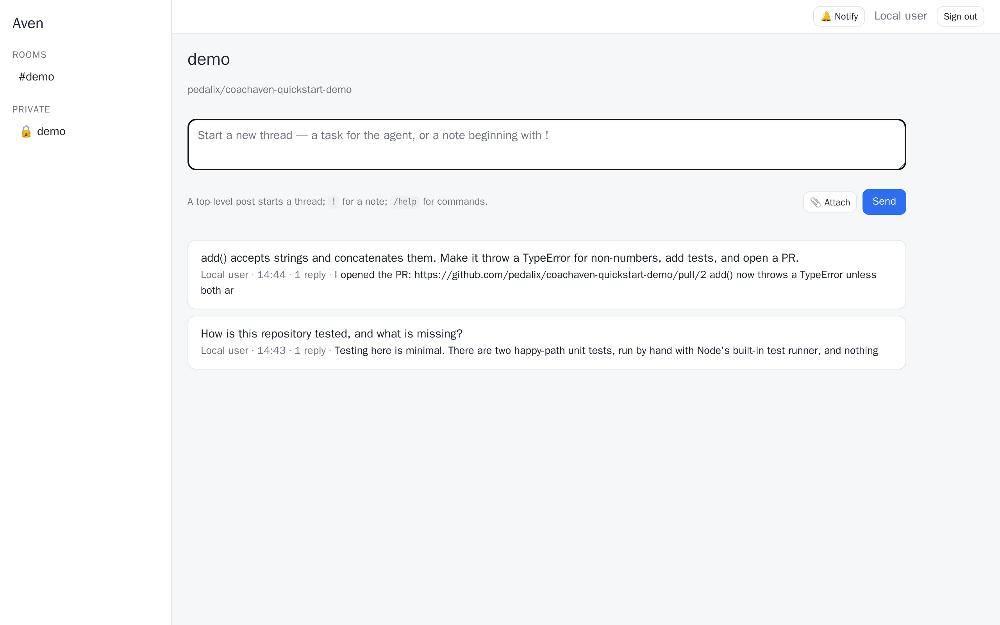

# Try it on one machine

CoachAven on one machine with Docker, from one command: the agent answers in a web chat on `localhost` about a GitHub
repository — our public demo, or yours — in an unprivileged sandbox container. You need a Claude subscription and Docker;
a GitHub token only if the agent should open pull requests. No Slack app, no identity provider, no registry or image
build of your own, no privileged container and no one else's approval. This is the trial path (OpenSpec `quickstart`): the same installation
layout as an operated one, with the safe settings. When you want more, see [Going on](#going-on).

**Measured:** rehearsals on a fresh Linux machine (a `docker:dind` container standing in for a clean VM, on a laptop's
network) on 2026-10-30 and, with this page's steps, on 2026-10-31; and on Docker Desktop under WSL. Most of the machine
time is downloading the two images once — 2 minutes on a good day, 10 on a slow one; after that, `up` takes seconds and
the first answer under a minute. The rest is your own time: signing in to Claude, and making a GitHub token if you want
pull requests (a few minutes each). A timed run on a clean cloud VM replaces these numbers after the next release.

## Before you start

| You need | For | Who |
|---|---|---|
| Docker: Docker Engine on Linux, or Docker Desktop (macOS, Windows with WSL) | the bot and the sandboxes | you |
| `git` | the clone | you |
| A Claude subscription (Pro or Max) — or an Anthropic Console account for an API key | the model | you |
| Optional: a GitHub repository you may push to | your own code and the agent's pull requests | you |

Run on: Docker Engine on Linux and Docker Desktop on Windows (WSL), 2026-10-30. macOS: not yet reported.

## The steps

| # | Step | Time |
|---|---|---|
| 1 | Clone at the latest release | 5 s |
| 2 | `quickstart/coach-aven up`: it pulls the two images, asks three questions and prints the sign-in link | 2–10 min (the download) + your answers |
| 3 | Ask in the project's room: the first answer (sandbox created, repository cloned) | 42 s |
| – | With a GitHub token: ask for a change, and the agent opens a pull request (without one: the change as a diff, 50 s) | 28 s |

**1. Clone at the latest release.**

```sh
git clone https://github.com/pedalix/coach-aven.git && cd coach-aven
git checkout "$(git describe --tags --abbrev=0)"
```

No `quickstart/coach-aven` after the checkout? The latest release predates it: stay on `main` (`git checkout main`).
The script then runs the image of that `main` commit, a canary build.

**2. Start it.**

```sh
quickstart/coach-aven up
```

`quickstart/` is the installation directory: its settings, its state and the bot's home live there, and git ignores
all of them. The first run copies `.env` and `projects.config.json` from their examples, pulls the bot image and the
sandbox image of this clone's commit, and asks only for what is missing — what you type is saved in `quickstart/.env`
and never printed:

| Question | Enter alone |
|---|---|
| **Claude**: a subscription token (`sk-ant-oat…`, from `claude setup-token` on any machine with Claude Code) or an API key | gets a token right there, from the sandbox image — no Claude Code to install: open the URL it shows, sign in, paste the code back, then paste the token it prints |
| **Repository** (`owner/repo`) the agent works on | our public demo, `pedalix/coachaven-quickstart-demo` |
| **GitHub token** for that repository | none: the agent reads the repository (a public one) and answers questions; asked for a change, it shows the diff instead of a pull request |

The GitHub token, for pull requests: github.com → Settings → Developer settings → Fine-grained tokens → Generate;
repository access *Only select repositories* (the one you named); permissions *Contents: Read and write* and *Pull
requests: Read and write*; an expiry. The sandbox can read this token, which is why it reaches one repository; for the
same reason, a team or clients use an Anthropic API key in its own workspace with a monthly spend limit rather than a
personal subscription. To change an answer later, edit `quickstart/.env` or `quickstart/projects.config.json` and run
`up` again.

A few seconds after the start it prints the `http://localhost:8787/login?key=…` link: open it. The key changes at every
start of the bot (`quickstart/coach-aven link` prints the current one); you stay signed in across restarts, and need a
new link only for a new browser. Another port than 8787: `AVEN_WEB_PORT=8790 quickstart/coach-aven up`.

<picture>
  <source media="(prefers-color-scheme: dark)" srcset="img/web-room-dark.png">
  
</picture>

**3. Ask.** Open the room `demo` and post a question about the repository — "what does this repository do, and how is
it tested?". The first answer takes longer: the bot creates the sandbox and clones the repository.

## What to ask next

| Try | What happens |
|---|---|
| "Add a section on running the tests to the README" | with a GitHub token, the agent works in its own branch and opens a pull request for you to review and merge; without one, it shows the diff |
| `/review #12` (a pull request of your repository; needs the GitHub token) | a read-only review in the room; `/review auto on` reviews every new pull request |
| `/schedule weekdays 9:00 \| open pull requests and what changed yesterday` | a recurring summary in the room |
| `/memory` | what the agent has learned about the project so far |
| `/status` | the sandbox, the sessions and the open pull requests |

Every command and button: the room's Home (`/help`), or [`commands.md`](commands.md). Projects beyond the trial —
several repositories, MCP servers, a Laravel Sail stack, a project prompt: the annotated
[`projects.config.example.json`](../projects.config.example.json) and [`configuration.md`](configuration.md).

## What runs where

- **The bot** (container `coach-aven-quickstart-bot-1`): the published image, the web chat on `127.0.0.1` only, the
  Docker socket to create the sandboxes. The socket is root-equivalent on this machine, which is why the agent never
  runs in this container.
- **The sandbox** (container `qs-demo`): unprivileged, no Docker socket, no Docker of its own; the repository, the
  Claude Code process, your two tokens. What an agent in a sandbox can and cannot reach: [`SECURITY.md`](../SECURITY.md).
- **The images:** both published by this repository's CI for every `main` commit and release, under one version name —
  `ghcr.io/pedalix/coach-aven` (the bot) and `ghcr.io/pedalix/coach-aven-sandbox-plain` (the sandbox: Claude Code, git,
  `gh`, Node, Python and the usual shell tools; no Docker). A project that needs more tools needs its own sandbox image:
  build one from `snapshot/plain` and name it with `SANDBOX_IMAGE=<image> quickstart/coach-aven up`.
- **The state:** `quickstart/` — `.env`, `projects.config.json`, `state.json`, the journals, `data/` (the chat's
  history), `home/`, `web-session.secret`.

Logs: `quickstart/coach-aven logs`. After an edit of `.env` or `projects.config.json`: `quickstart/coach-aven up` (it
always restarts the bot, which reads both only when it starts). Stop: `quickstart/coach-aven down`.

## Uninstall

```sh
quickstart/coach-aven uninstall
```

It stops the bot, removes the sandbox containers (they are not compose services, and they hold your tokens) and the
two images of this version. Then delete the clone, or only `quickstart/`'s untracked files: `git clean -fdX
quickstart/` (your `.env`, the state and the chat's history go with them).

## Going on

- **Slack beside the web chat**, on this very installation: create a Slack app from
  [`slack-app-manifest.json`](../slack-app-manifest.json) (Socket Mode on), uncomment the three Slack lines at the end of
  `quickstart/.env` with its bot token (`xoxb-…`) and app token (`xapp-…`), and `quickstart/coach-aven up`. A channel named
  `aven-demo` drives the project `demo`: invite the bot and @mention it there.
- **Microsoft Teams** needs a public HTTPS endpoint and a bot identity: [`teams.md`](teams.md).
- **More than one person** in the web chat: an identity provider, `WEB_AUTH=oidc` ([`web.md`](web.md)).
- **Sandboxes on another host**: `SANDBOX_HOST=user@host` ([`sandbox-drivers.md`](sandbox-drivers.md)).
- **A server you operate**: the ops tooling ([`../infra/README.md`](../infra/README.md)). Copy `.env`,
  `projects.config.json` and `projects.d/` into the installation's ops repository; the state and `home/` stay out of it.
