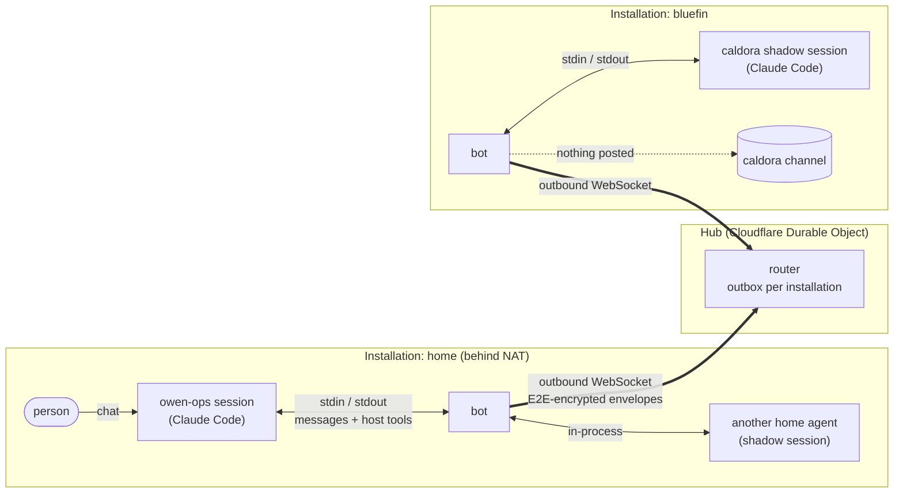
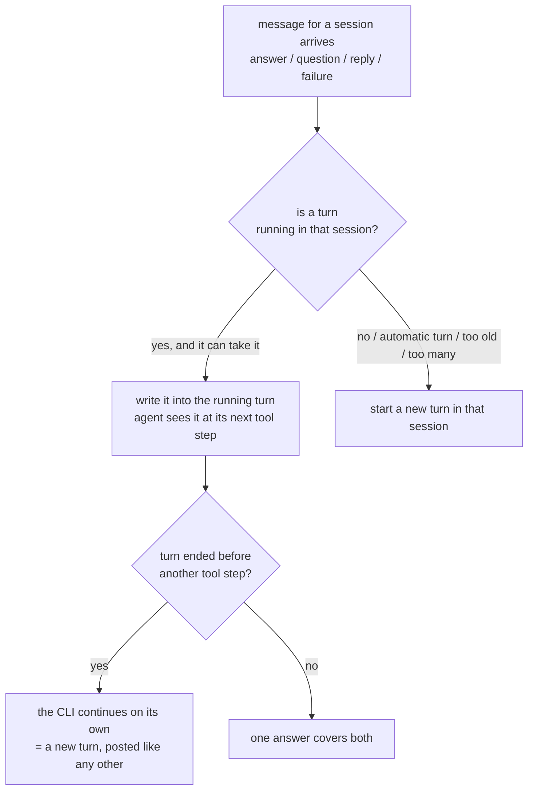
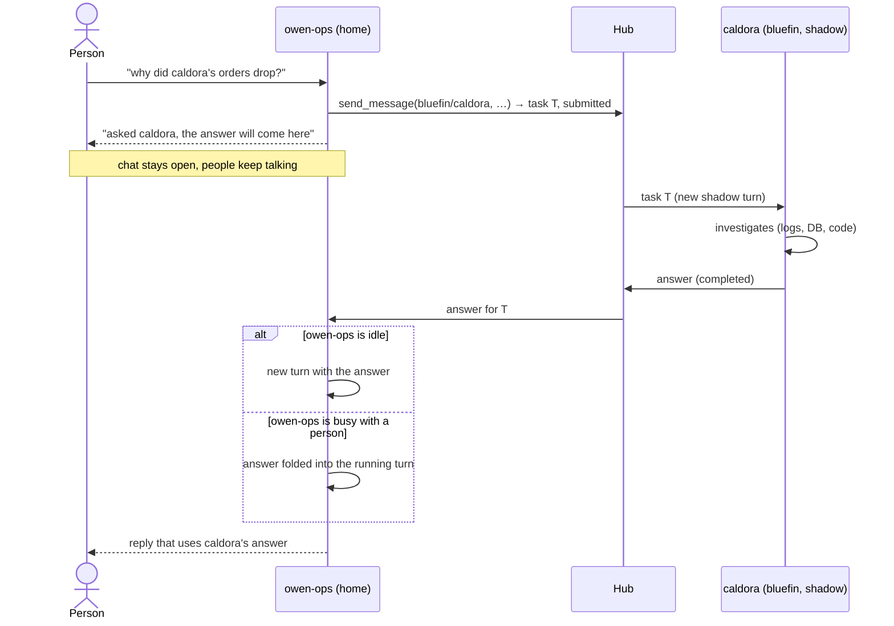
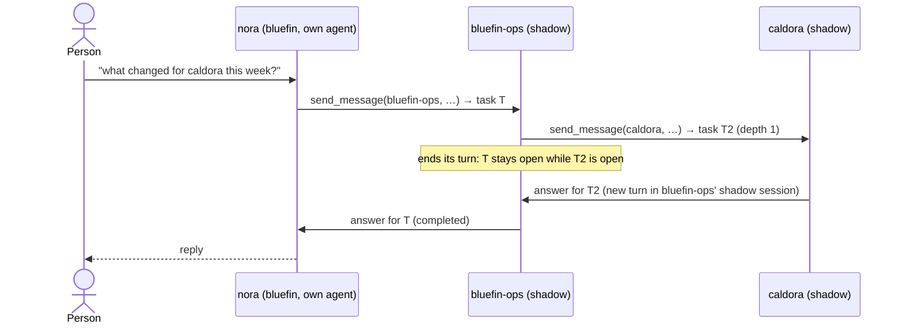
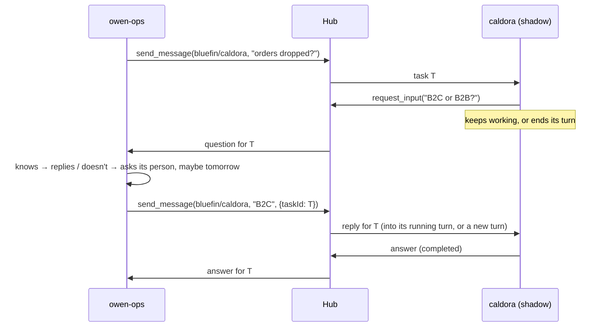
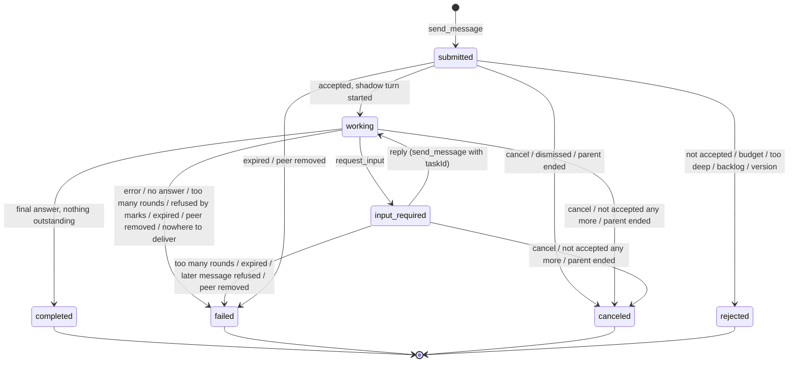

# Agent messaging — overview

High-level behaviour of the communication layer this change introduces. This page has no implementation detail; for that, see `design.md`, and for the contract, see `specs/`.

The layer is a property of the system, not a feature for one agent. Any agent the bot runs can ask any agent that accepts it, in the same installation or in another one, and the answer comes back into the asking session.

## Who uses it

- **A tenant agent across installations.** The operator's tenant agent asks projects that run in other installations, for example "why did caldora's orders drop yesterday?".
- **A person's own agent.** It is fed with that person's work context, and asks the agents that have more access, then answers the person.
- **A routine.** A weekly report wakes up, asks several agents and composes their answers.

## Pieces

- **Agent**: a Claude Code session the bot drives for a project. The project may be a project agent, a tenant agent, or a person's own agent.
- **Bot**: turns agent tool calls into messages and messages into turns. Inside one installation the messages stay in the bot. Between installations the bot is the only thing that talks to the hub.
- **Hub**: admits enrolled installations, routes between them, and keeps undelivered envelopes. It cannot read them.
- **Task**: one conversation between two agents, with an id and a state (A2A).
- **Shadow session**: the answering agent's own session for one task. Its turns never appear in chat.

## Who may ask whom

- **Sending is configured.** A project configured to send gets the sending tools.
- **Each agent lists who may ask it.** Entries are specific agents, or `*` for every agent of its own domain; another domain's agents are always named. The receiving installation checks the list for every message.
- **The hub does not decide.** It only knows which installations exist.
- **Accepting is granting.** Accepting an asker gives the asker, and whoever may drive it, what this agent answers.

## The tools an agent has

| Asking agent | Answering agent |
|---|---|
| `send_message(target, text, {taskId?})` — start a task, or reply on one | `request_input(question)` — ask back |
| `get_task(taskId)` — state, last message (only in the conversation that sent it) | its final answer ends the task, once nothing is outstanding |
| `cancel_task(taskId)` | if its project may send, the asking tools too (a chain) |
| `agents(installation?)` — who accepts me | |

A target is `bluefin/caldora`, or just `caldora` in the own installation. Every tool returns at once, and nobody waits with a turn open.

## One rule for every message that comes back

- **Framed as data.** The message is always framed as **data from another agent**, never as a person's instruction. It also lists what is still open from the same conversation.
- **Delivered once.** It counts as delivered only when the agent's process has taken it up. If the process dies first, it is delivered again as a new turn; while the process lives, it is never sent twice.

## When a task is done

The answering session's final answer completes the task only when nothing is outstanding. Something is outstanding while:
- a question asked back with `request_input` has no reply yet;
- a task the session itself sent is still open;
- a message for the session has not been taken up yet;
- a background subagent is still running.

Until then the answer is kept as a progress note (`get_task` shows it), and the task stays open. If everything resolves and no turn follows, the bot asks the agent once for its final answer. If that brings none, the task fails rather than waiting forever.

## Guard rails

- **No forwarding between domains without a person.** A domain is one installation, or one client workspace inside a multi-workspace installation.
  - A conversation that received data from domain X cannot send it to domain Y, unless Y already had it.
  - It may still answer X, and ask agents of its own domain, which then carry the same mark.
  - In a chat thread the message waits for a person's Send; in a shadow session it is refused.
  - A fresh session starts clean; compaction does not clear it.
  - The bot's own posts in such a conversation are not ingested into the project's sources, so the data cannot come back through the store.
- **Questions and requests alike.** A task may ask for an answer or for work. What the answering agent may do is decided by its own project's rules and its sandbox's permissions, and who may send to it by its accept list (`retire-agent-dispatch` D3).
- **Limits:**
  - tasks per day on both sides;
  - clarification rounds per task;
  - chain depth 3;
  - injected messages per turn.
- **Fail loudly.** Every refusal, message that cannot be delivered, slow or lost pickup, mismatch, limit and mark is logged. From warning up it reaches Sentry.

## Ask and answer across installations

## A person's own agent asks inside its installation

## Clarification

## Task states

A held new task is a `submitted` task that has not left its installation yet: Send releases it, and Dismiss cancels it. A held reply leaves its task in `input-required` until a person decides.

## What survives what

| Event | What happens |
|---|---|
| Asking bot restarts | Open tasks live in its state, and answers wait at the hub and arrive on reconnect. |
| Bot restarts right after writing a message into a turn | On reattach the bot sees whether the agent took it up; the message is sent again only if the process died. |
| Answering bot restarts mid-turn | The shadow turn is recovered like any chat turn, and the answer still goes out once. |
| Hub unreachable | Messages between installations wait in the sender's state. Local messages and chat keep working. |
| Recipient offline for days | The hub keeps the envelope until it is acknowledged or expires (7 days). |
| Sandbox killed before the agent took a message up | The message is delivered again as a turn. |
| A person keeps chatting meanwhile | Their messages are ordinary turns. The answer joins whichever turn is running, or starts its own. |
| Host clock drifts | Nothing breaks, and the bot warns once it is more than 30 s off. |
| A session is compacted | The conversation keeps its marks; only `🔄 Restart session` clears them. |

## Where it can grow

- **Third-party agents:** an A2A HTTP adapter on the hub, translating to the same task shapes, with keys per agent.
- **People in the loop on the answering side:** mirroring a shadow session into a channel, per pair.
- **Hard read-only answering:** a Claude Code permission mode per shadow session.
- **Asking for work, not only answers:** dispatch across installations, with the target's own Send button.
